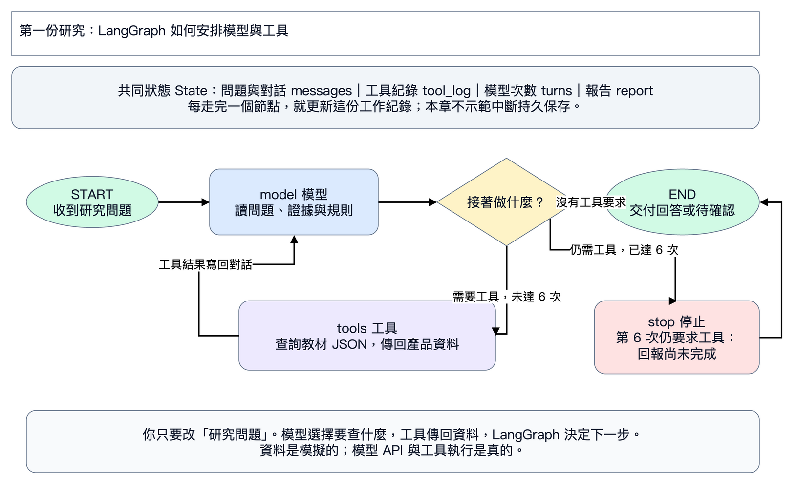
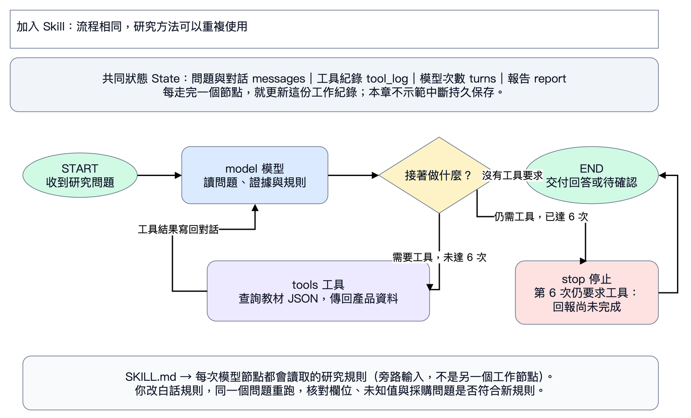
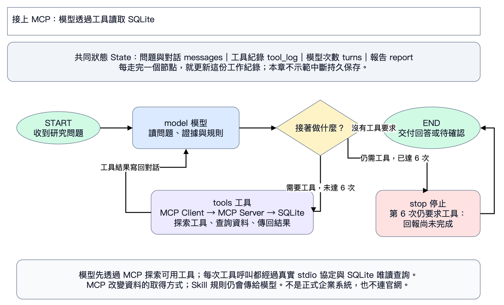

# 第一天下午：交辦需求，讓 AI 修改，再驗收

對照原投影片 PDF 95–172 頁。95–124 頁概念由老師帶過，直接從第一份研究開始操作。這次更新限第一天下午；第二天保留既有教材，之後再同步。

|順序|你會做什麼|開啟 Colab|只要改哪裡|
|---|---|---|---|
|1 第一份研究|交辦、看工具紀錄、修改需求|[第一份產品研究](https://colab.research.google.com/github/ywchiu/hp_agent/blob/main/workshop_20261105/notebooks/01_first_research.ipynb)|`NEW_TASK` 的中文問題|
|2 加入 Skill|把研究方法存成可重複使用的規則|[修改研究 Skill](https://colab.research.google.com/github/ywchiu/hp_agent/blob/main/workshop_20261105/notebooks/02_skill_mcp.ipynb)|`research_skill` 的白話規則|
|3 接上 MCP|透過工具查 SQLite，辨認查不到與連線失敗|[查詢企業資料庫](https://colab.research.google.com/github/ywchiu/hp_agent/blob/main/workshop_20261105/notebooks/02b_company_database.ipynb)|`NEW_TASK` 中的查詢要求|

每份 notebook 上方先放狀態圖，再逐步說明「為什麼做、按哪裡／改什麼、應該看到什麼、卡住如何請 AI 修正」。不必先讀程式；底層程式預設收起，保留可展開的明文原始碼。

老師當堂提供模型 API Key，同學在執行時輸入框貼上，不用自行申請。每章獨立執行、輸入一次，重啟執行階段要重新輸入。模型預設 `gpt-6-luna`，由老師依課堂可用模型調整。每章研究前後各跑一次，每次最多六次模型呼叫。

DemoBook 與產品規格為教學模擬資料；模型 API、LangGraph、MCP 協定與 SQLite 查詢會真的執行。沒有即時官網研究，也沒有連到正式企業資料庫。

## 先看懂這三張圖







State 就是助理帶著走的工作紀錄：你的問題、工具結果、呼叫次數、報告。模型決定是否要用工具，LangGraph 按箭頭安排下一步；Skill 提供方法，MCP 提供取得資料的通道。

## 每章照同樣六步做

1. 開 Colab、儲存副本，依序播放準備範例的三格，看到產品表。
2. 在輸入框貼老師提供的 Key；模型名稱照老師指定。
3. 執行原始問題，保留第一份報告與工具紀錄。
4. 改一段中文問題或研究規則，也可以把指定儲存格與需求交給 AI 修改。
5. 重跑修改版，確認新要求生效、產品事實沒被改寫。
6. 下載本章成果 ZIP，交出前後報告與自己的觀察。

第一份報告要核對：只有台灣兩筆；16 GB 保固 1 年；32 GB 保固待確認；不可引用美國版 3 年來補。Skill 章要指出新增規則是否生效。MCP 章改查 `DEMO-TW-999`，要看到 `mcp` 工具紀錄、`not_found` 和承認查不到的回答。模型沒做到就修問題／規則再跑，不把錯誤回答當完成。

## 使用 Antigravity 示範

開啟這個 GitHub 專案的本機工作區後，直接貼 [第一份任務](../prompts/01_first_research.txt)。讓 AI 安裝套件、指出執行方式及準備修改；同學專注在需求和結果。接著依序貼 [Skill 任務](../prompts/02_skill.txt) 與 [MCP 任務](../prompts/03_mcp.txt)，一次一個。

Antigravity 對話使用平台帳號的模型；若示範本教材的 LangGraph 程式，使用相同的課堂 Key，本機會優先讀本專案 `.env`；沒有設定才由同學在互動式終端輸入。程式不把 Key 寫進報告。不要把 Key 貼到 AI 對話裡。AI 可以協助改程式與執行步驟，但「完成」仍要以報告與工具紀錄驗收。

老師若要直接示範 Antigravity 透過 MCP 呼叫工具，讓 AI 使用 [company_database.py](company_database.py) 配置 `company-database` stdio 服務，再核對模型的實際工具紀錄。Colab 已把同一套服務串好，同學不用手動設定。

## 講師本機備用命令

以下工作可交給 Antigravity 準備，同學主線使用上方 Colab。

```sh
cd workshop_20261105
python3 -m venv .venv
.venv/bin/python -m pip install -r day1/requirements.txt
.venv/bin/python day1/research_agent.py --out runs/day1/01
.venv/bin/python day1/research_agent.py --skill --out runs/day1/02
.venv/bin/python day1/research_agent.py --skill --mcp --out runs/day1/03
```

本機程式優先讀取專案根目錄 `.env` 的 `OPENAI_API_KEY` 或 `OPENAIAPI_KEY`；沒有時才顯示 Key 輸入提示。修改規則使用 [SKILL.md](SKILL.md)；修改問題讓 AI 在命令加上 `--task "你的中文問題"`，並換一個 `--out` 留下前後版本。Colab 仍使用老師當堂提供的隱藏輸入框，不需上傳 `.env`。
