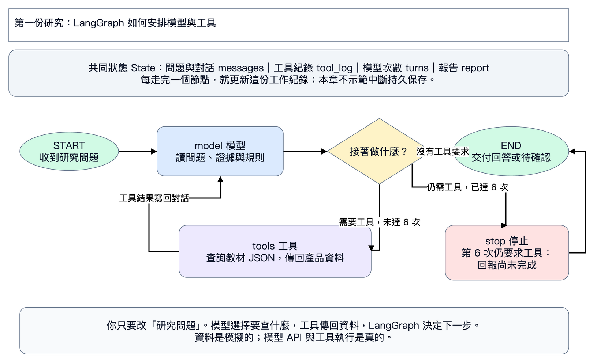

# L01｜第一份產品研究

對照 PDF 125–142 頁。先開 [第一份研究 Colab](https://colab.research.google.com/github/ywchiu/hp_agent/blob/main/workshop_20261105/notebooks/01_first_research.ipynb)，或在 Antigravity 貼 [P01](../prompts/01_first_research.txt)。

1. 看上方狀態圖，依序播放準備範例的三格，看到三筆產品表，不用改底層程式。
2. 在執行時輸入框貼老師提供的 Key。
3. 執行起始研究，對照資料：只能比較兩筆 TW，16 GB 保固 1 年，32 GB 保固待確認，保留 ID 與日期。
4. 只改 `NEW_TASK` 的中文，要求增加採購問題，也可以用 notebook 內的指令請 AI 幫你改寫。
5. 重跑修改版，逐項核對新要求。

如果回答沒符合要求，將問題、結果與具體錯誤貼給 AI，要求只修改研究問題或規則，再跑一次。不要把老師的 Key 貼給 AI。完整逐步說明與排錯都已放在 Colab 每一步上方。

交付：前後問題、報告、工具紀錄，以及一句「我改了什麼，如何確認生效」。下一章：[Skill 與 MCP](02_skill_mcp.md)。
