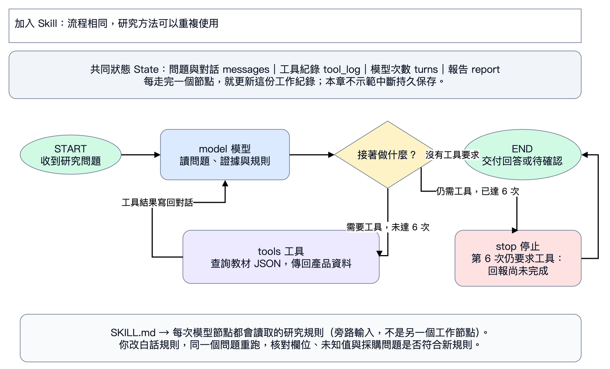
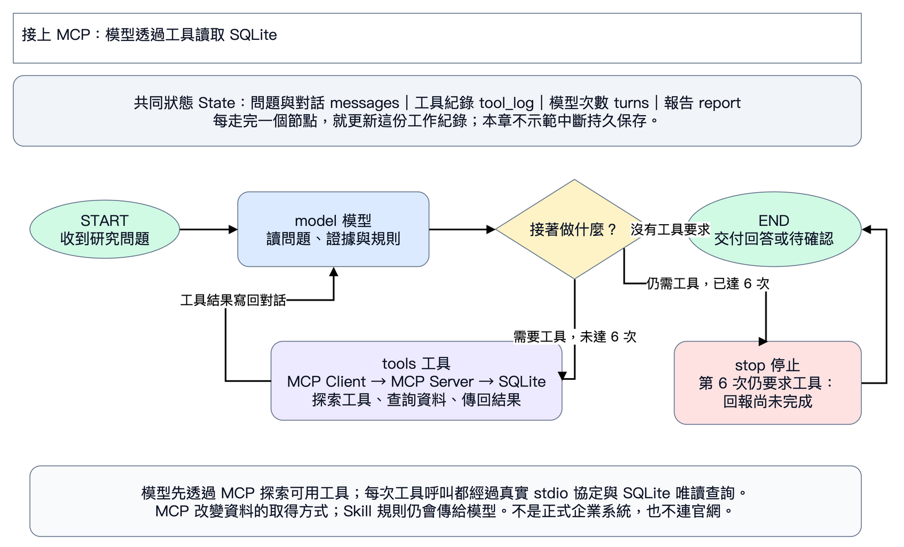

# L02｜先改 Skill，再接 MCP

對照 PDF 143–172 頁，拆成兩份獨立 Colab，一次只練一個改變。

## L02A：用白話規則改研究方法

開 [Skill Colab](https://colab.research.google.com/github/ywchiu/hp_agent/blob/main/workshop_20261105/notebooks/02_skill_mcp.ipynb)，Antigravity 使用 [P02](../prompts/02_skill.txt)。

1. 看圖：模型與工具流程不變，每次模型呼叫多讀一份研究規則。
2. 準備範例、輸入老師的 Key，先跑沒有 Skill 的基準報告。
3. 在 `research_skill` 白話內容中加上「向採購主管提供三句摘要」，或請 AI 只改這一格。
4. 重跑相同問題，核對摘要、來源、日期、未知值。原稿已正確時如實說明，只比較實際變化。
5. 下載成果 ZIP，保留 Skill 與前後報告。

Skill 是方法，產品 JSON 是事實；改規則不能讓原本缺漏的保固變成已知。

## L02B：透過 MCP 查 SQLite

開 [MCP Colab](https://colab.research.google.com/github/ywchiu/hp_agent/blob/main/workshop_20261105/notebooks/02b_company_database.ipynb)，Antigravity 使用 [P03](../prompts/03_mcp.txt)。

1. 準備範例並播放 MCP 服務格。程式自動啟動 stdio、探索兩個工具、初始化教學 SQLite。
2. 輸入老師的 Key，跑相同研究問題；核對工具紀錄標示 `mcp`。
3. 只改 `NEW_TASK`，詢問不存在的 `DEMO-TW-999`。
4. 重跑，確認 `read_product_by_id` 回傳 `not_found`，模型承認資料不足，沒有改用其他產品編造答案。
5. 下載包含工具紀錄、報告及 SQLite 的 ZIP。

查不到是資料結果；連線失敗是工具問題。請 AI 修連線時，要求保留 MCP，不可改讀 JSON 冒充成功。每個操作格上方的完整原因、步驟、預期結果與修正指令都在 Colab 裡。
