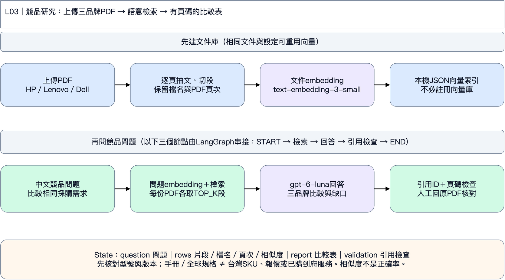

# L03｜用真實官網片段做 RAG 查證

第二天｜台灣企業 120 台商務筆電採購案｜先看狀態圖，再依五步操作。

問題 → 詞彙檢索 → 模型回答 → 引用 ID 檢查。這是檢索後生成；未使用向量資料庫或 embedding。

**State 是工作紀錄：** question 問題、rows 取回片段、report 回答、validation 引用檢查。節點是分工，箭頭是下一步；只有 L05、L06 示範把狀態保存到 SQLite，L03重跑會重新呼叫模型；L04相同輸入會沿用已完成角色的回覆快取，修改需求後才產生新回覆。

**情境：** 業務／顧問 60 台、工程／分析 40 台、行政／管理 20 台，共 120 台；含稅總預算 NT$600 萬，預計 2027-01-15 前交貨。比較 HP EliteBook 8 G1a 14 Next Gen AI、Lenovo ThinkPad T14 Gen 6 AMD、Dell Pro 14 Plus PB14250 **Core Ultra 200V**。需要 32 GB、1 TB、出差配置 ≤1.5 kg、Win11 Pro、底座／雙螢幕、安全、台灣三年到府與正式報價。

**資料界線：** 企業、數量、預算及日期是教學情境；產品與服務片段來自真實官方網頁，查閱日為 2026-11-05。29 筆中有 27 筆可用、1 筆桌機服務陷阱、1 筆 HP 搜尋索引待核實線索。官網能力或海外 SKU 不等於台灣出貨／保固／報價。預算除以台數的 NT$50,000 是情境上限，不能當成市場價格。沒有台灣報價，結論可以是「待詢價」。

對照 PDF 173–221；建議 40 分鐘。程式格請在[本章Colab](https://colab.research.google.com/github/ywchiu/hp_agent/blob/main/workshop_20261105/notebooks/03_rag.ipynb)播放。使用Antigravity時貼[本章指令](../prompts/04_rag.txt)；程式入口見[第二天教材](../day2/README.md)。

## 第 1 步｜開啟本章，準備資料

**為什麼：** 每份 notebook 都自帶完整明文程式、採購需求及來源片段，可以獨立跑，不依賴上一章 Colab 暫存檔。

**怎麼做：** 存一份 Colab 副本，選 Python 3、CPU。由上往下播放下面三格；程式預設收起，不用展開修改。最後會看到來源表。可點來源網址核對內容，網站有時會擋機器連線，因此課堂主流程使用附帶的封存摘述，不會假裝剛完成線上搜尋。

**看什麼：** GLOBAL 是系列能力，IE 是愛爾蘭 SKU，TW 服務頁也未必是這一台已購買的服務。HP-SPEC 目前僅搜尋索引可見、直接存取 403，程式會排除它。

**卡住時給 AI：**「請依最後一段錯誤修復這個 Colab，保留 LangGraph、來源查核與未知值，只告訴我需要替換及重跑的格子。」只貼錯誤與對應格，不貼 Key。若要求重啟執行階段，重啟後從本步重跑。

## 第 2 步｜輸入課堂 Key

**怎麼做：** 播放下格，在輸入框貼上老師提供的 Key，按 Enter。預設模型是 `gpt-6-luna`，不用自己申請 Key。每份 notebook 都需輸入，執行階段結束後會消失。

**應該看到：** Key 已暫存與模型名稱，不會顯示 Key。本章真的呼叫模型，重跑會產生用量。401 請老師確認 Key；429 請老師確認課堂額度；模型不存在時使用老師指定名稱。只回報錯誤碼，不貼 Key，不要將 Key 放進 AI 對話或 GitHub。

## 第 3 步｜先跑一次，觀察資料是否足夠

**怎麼做：** 先不改下格，播放後閱讀報告與 `validation`。這次只取 4 段，問題卻涵蓋三品牌；資料不足應保留待確認，不能靠模型記憶補答案。

**應該看到：** 每筆取回片段的 ID、範圍與原文位置。ID 檢查通過只代表引用存在，仍須點官網確認這段真的支持結論。若資料不足，應提出補查問題。

## 第 4 步｜改問題與閱讀範圍

**怎麼做：** 只改下格中文問題與片段數。先聚焦 Lenovo、台灣三年到府與不同配置重量；片段數改成 10。這次讓資料量配合問題範圍，其他程式不動。

**給 AI 的指令：**「請把研究問題縮小到 Lenovo ThinkPad T14 Gen 6 AMD，要求區分筆電／桌機服務及不同配置重量，保留來源 ID 與待確認；只回傳 NEW_QUESTION 與 TOP_K 兩行。」

**先預測：** 1.38 kg 與 1.59 kg 可以同時成立嗎？桌機次工作日到府能拿來證明筆電服務嗎？

## 第 5 步｜重跑，檢查改善與排除理由

**怎麼做：** 播放下格。比較前後報告，對照 Lenovo PSREF 第 5 頁與台灣服務頁「筆記型電腦」章節。下面另列同一問題的未篩選候選與實際排除片段。

**應該看到：** Lenovo 有些灰色配置超過 1.5 kg；筆電保固頁不能支持三年次工作日到府。桌機片段及僅索引線索被排除。海外 SKU 和全球系列仍可當候選能力證據，不能轉成台灣已出貨的結論。加大 k 不保證正確，只是讓模型多讀片段。

**驗收：** 前後答案都可能謹慎；如實寫改善的是涵蓋率／條件說明，不要製造原稿一定錯的說法。
