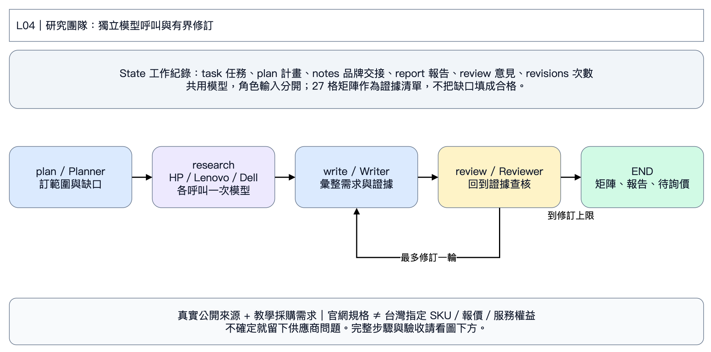

# L04｜三品牌研究團隊與 27 格需求矩陣

第二天｜台灣企業 120 台商務筆電採購案｜先看狀態圖，再依六步操作。

Planner 規劃 → 三個品牌 Researcher 分別呼叫模型 → Writer 寫稿 → Reviewer 查核 → 最多修訂一輪。角色各有獨立輸入輸出；共用同一模型，沒有各自長期記憶。

**State 是工作紀錄：** task 任務、plan 計畫、notes 品牌交接、report 草稿、review 意見、revisions 修訂次數。節點是分工，箭頭是下一步；只有 L05、L06 示範把狀態保存到 SQLite，L03重跑會重新呼叫模型；L04相同輸入會沿用已完成角色的回覆快取，修改需求後才產生新回覆。

**情境：** 業務／顧問 60 台、工程／分析 40 台、行政／管理 20 台，共 120 台；含稅總預算 NT$600 萬，預計 2027-01-15 前交貨。比較 HP EliteBook 8 G1a 14 Next Gen AI、Lenovo ThinkPad T14 Gen 6 AMD、Dell Pro 14 Plus PB14250 **Core Ultra 200V**。需要 32 GB、1 TB、出差配置 ≤1.5 kg、Win11 Pro、底座／雙螢幕、安全、台灣三年到府與正式報價。

**資料界線：** 企業、數量、預算及日期是教學情境；產品與服務片段來自真實官方網頁，查閱日為 2026-11-05。29 筆中有 27 筆可用、1 筆桌機服務陷阱、1 筆 HP 搜尋索引待核實線索。官網能力或海外 SKU 不等於台灣出貨／保固／報價。預算除以台數的 NT$50,000 是情境上限，不能當成市場價格。沒有台灣報價，結論可以是「待詢價」。

對照 PDF 222–261；建議 60 分鐘。程式格請在[本章Colab](https://colab.research.google.com/github/ywchiu/hp_agent/blob/main/workshop_20261105/notebooks/04_research_loop.ipynb)播放。使用Antigravity時貼[本章指令](../prompts/05_research_team.txt)；程式入口見[第二天教材](../day2/README.md)。

## 第 1 步｜開啟本章，準備資料

**為什麼：** 每份 notebook 都自帶完整明文程式、採購需求及來源片段，可以獨立跑，不依賴上一章 Colab 暫存檔。

**怎麼做：** 存一份 Colab 副本，選 Python 3、CPU。由上往下播放下面三格；程式預設收起，不用展開修改。最後會看到來源表。可點來源網址核對內容，網站有時會擋機器連線，因此課堂主流程使用附帶的封存摘述，不會假裝剛完成線上搜尋。

**看什麼：** GLOBAL 是系列能力，IE 是愛爾蘭 SKU，TW 服務頁也未必是這一台已購買的服務。HP-SPEC 目前僅搜尋索引可見、直接存取 403，程式會排除它。

**卡住時給 AI：**「請依最後一段錯誤修復這個 Colab，保留 LangGraph、來源查核與未知值，只告訴我需要替換及重跑的格子。」只貼錯誤與對應格，不貼 Key。若要求重啟執行階段，重啟後從本步重跑。

## 第 2 步｜輸入課堂 Key

**怎麼做：** 播放下格，在輸入框貼上老師提供的 Key，按 Enter。預設模型是 `gpt-6-luna`，不用自己申請 Key。每份 notebook 都需輸入，執行階段結束後會消失。

**應該看到：** Key 已暫存與模型名稱，不會顯示 Key。本章真的呼叫模型，重跑會產生用量。401 請老師確認 Key；429 請老師確認課堂額度；模型不存在時使用老師指定名稱。只回報錯誤碼，不貼 Key，不要將 Key 放進 AI 對話或 GitHub。

## 第 3 步｜先看研究規模，找最重要的缺口

**怎麼做：** 播放下格，看到三品牌 × 九項需求，共 27 格。這是可追溯的檢查清單，不是打分排行榜；有系列證據仍不能代表台灣 SKU 合規。

**討論：** 工程師在意可升級、業務在意重量、採購在意到府與交期，哪三件最需要供應商回答？所有品牌都沒有正式含稅報價，所以目前不能排名最便宜。

## 第 4 步｜交辦完整研究，讓 AI 修改需求

**怎麼做：** 只改 TASK。先用預設採購題，或加入你負責部門的優先項目。修訂上限設 1；改 0 可比較沒有 Writer 修訂的報告。程式會依上限停止，不等所有缺口填滿。

**給 AI 的指令：**「請將120台企業採購任務寫清楚，加入〔你的部門優先需求〕。保留九項驗收、台灣市場、正式報價與服務待確認，不指定假贏家。只回傳 TASK 字串。」

## 第 5 步｜執行角色交接，必要時上網補查

**怎麼做：** 播放第一格，等報告與 Reviewer 意見出現。一次新研究最多8次模型呼叫，各角色開始與完成都會顯示。相同任務重跑沿用已完成角色回覆，避免逾時後整組重做；修改需求則使用新回覆。可能需要幾分鐘；不要因等待重複按播放。`trace.json` 保留各角色內容、證據 ID 與模型呼叫紀錄，`coverage.csv` 可開試算表。

**驗收：** Dell 200V 的記憶體不能升級；HP 愛爾蘭32GB/1TB不能當台灣SKU；Lenovo 保固不等於到府。Reviewer 的意見必須回到原始來源，不把 Writer 文字當新證據。達上限後仍交付未解問題。

**選做真實上網：** 下方第二格將 SEARCH_NOW 改 True，再播放。沿用老師的 Key，用模型的 web_search 搜尋官方站，最多兩次工具呼叫；保存網址與查閱時間。可能有額外搜尋費用。網站擋取或找不到台灣 SKU 就保留缺口，不可冒充查到。搜尋結果先作候選，須人工開啟核對後才可要求 AI 更新封存資料；不自動混進27格的證據。

**給 AI：**「根據 coverage.csv 和 Reviewer 意見，只列前三個最值得補查的問題、要找的官方頁面與驗收方式；不要把市場或系列能力換成已確認SKU。」

## 第 6 步｜下載成果並互相驗收

**怎麼做：** 播放下格，下載本章 ZIP。裡面包含需求副本、來源及片段、這次報告和流程紀錄；不含 Key。沒有自動下載時，從 Colab 左側「檔案」下載同名 ZIP。保存 notebook 不會保留暫存資料夾，所以離開前要下載。

**交給同學檢查：** 一項有依據的發現、一項仍待確認的條件，以及你修改需求後輸出改變的證據。將報告、片段與需求交給 AI：「請逐項核對結論、適用市場、配置、引用與未知值，列出仍需人工確認的問題。」不要以文字流暢當成驗收通過。

L05／L06 的 ZIP 另含 checkpoint 與操作 SQLite。要在全新 Colab 接續，先播放第 1、2 步，再用「選做：還原上次下載的ZIP」格還原。L05按原順序往下會沿用既有進度，L06從第3步讀回待審稿；已結束的審核不能再次修改，需開新REVIEW_DIR。原Thread、模型和需求必須保持相同。程式不會自動把 Colab 暫存檔備份到雲端。
