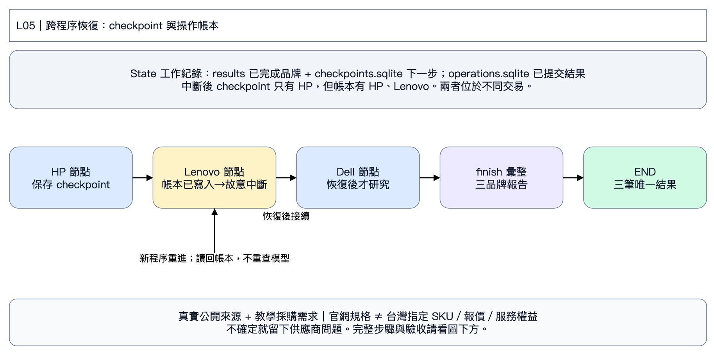

# L05｜120 台研究案中斷後接續

第二天｜台灣企業 120 台商務筆電採購案｜先看狀態圖，再依六步操作。

HP → Lenovo → Dell → 彙整；每個完成節點寫 checkpoint。課堂故意在 Lenovo 結果存入操作帳本後中斷，讓你看到帳本與 checkpoint 的差別。

**State 是工作紀錄：** results 已完成品牌；next 下一節點另存在 checkpoint；operations.sqlite 是已提交結果帳本。節點是分工，箭頭是下一步；只有 L05、L06 示範把狀態保存到 SQLite，L03重跑會重新呼叫模型；L04相同輸入會沿用已完成角色的回覆快取，修改需求後才產生新回覆。

**情境：** 業務／顧問 60 台、工程／分析 40 台、行政／管理 20 台，共 120 台；含稅總預算 NT$600 萬，預計 2027-01-15 前交貨。比較 HP EliteBook 8 G1a 14 Next Gen AI、Lenovo ThinkPad T14 Gen 6 AMD、Dell Pro 14 Plus PB14250 **Core Ultra 200V**。需要 32 GB、1 TB、出差配置 ≤1.5 kg、Win11 Pro、底座／雙螢幕、安全、台灣三年到府與正式報價。

**資料界線：** 企業、數量、預算及日期是教學情境；產品與服務片段來自真實官方網頁，查閱日為 2026-11-05。29 筆中有 27 筆可用、1 筆桌機服務陷阱、1 筆 HP 搜尋索引待核實線索。官網能力或海外 SKU 不等於台灣出貨／保固／報價。預算除以台數的 NT$50,000 是情境上限，不能當成市場價格。沒有台灣報價，結論可以是「待詢價」。

對照 PDF 262–306；建議 40 分鐘。程式格請在[本章Colab](https://colab.research.google.com/github/ywchiu/hp_agent/blob/main/workshop_20261105/notebooks/05_recovery.ipynb)播放。使用Antigravity時貼[本章指令](../prompts/06_recovery.txt)；程式入口見[第二天教材](../day2/README.md)。

## 第 1 步｜開啟本章，準備資料

**為什麼：** 每份 notebook 都自帶完整明文程式、採購需求及來源片段，可以獨立跑，不依賴上一章 Colab 暫存檔。

**怎麼做：** 存一份 Colab 副本，選 Python 3、CPU。由上往下播放下面三格；程式預設收起，不用展開修改。最後會看到來源表。可點來源網址核對內容，網站有時會擋機器連線，因此課堂主流程使用附帶的封存摘述，不會假裝剛完成線上搜尋。

**看什麼：** GLOBAL 是系列能力，IE 是愛爾蘭 SKU，TW 服務頁也未必是這一台已購買的服務。HP-SPEC 目前僅搜尋索引可見、直接存取 403，程式會排除它。

**卡住時給 AI：**「請依最後一段錯誤修復這個 Colab，保留 LangGraph、來源查核與未知值，只告訴我需要替換及重跑的格子。」只貼錯誤與對應格，不貼 Key。若要求重啟執行階段，重啟後從本步重跑。

## 第 2 步｜輸入課堂 Key

**怎麼做：** 播放下格，在輸入框貼上老師提供的 Key，按 Enter。預設模型是 `gpt-6-luna`，不用自己申請 Key。每份 notebook 都需輸入，執行階段結束後會消失。

**應該看到：** Key 已暫存與模型名稱，不會顯示 Key。本章真的呼叫模型，重跑會產生用量。401 請老師確認 Key；429 請老師確認課堂額度；模型不存在時使用老師指定名稱。只回報錯誤碼，不貼 Key，不要將 Key 放進 AI 對話或 GitHub。

### 選做：在全新 Colab 還原上次的成果 ZIP

第一次上課跳過。若要接續上次進度，先用左側「檔案 → 上傳」放入ZIP，再只填下格檔名並播放。接下來照原步驟操作；程式會沿用已還原的任務，不重新建立。請用全新執行階段，不能覆蓋已有成果的資料夾。

## 第 3 步｜啟動批次，保留中斷現場

**怎麼做：** 播放下格。它會開一個獨立 Python 程序，實際研究 HP、Lenovo，然後在寫好 Lenovo 結果、尚未完成節點時故意停止。這個失敗是教學故障，不代表官網或模型故障。

**應該看到：** `LESSON_PAUSE_AFTER_LENOVO_EFFECT`、結束碼 23。這是預期結果；若是401、逾時或其他錯誤，程式會另報錯，不會將它當成成功中斷。準備重演時請改新的 BATCH_DIR，不要刪掉中斷進度。

## 第 4 步｜只讀進度，說明為什麼不能全部重跑

**怎麼做：** 播放下格，對照完成品牌、下一節點、唯一結果筆數與執行紀錄。

**應該看到：** checkpoint 只有 HP 完成，next 是 Lenovo；操作帳本已有 HP、Lenovo 各一筆。兩者不矛盾：結果提交後、節點完成前中斷，checkpoint 還沒追上。

**給 AI：**「請根據這份中斷狀態說明應從哪個節點接續，以及哪一筆可能重進；只解釋，不刪SQLite、不改Thread、不重做已完成品牌。」同 Thread、同來源與模型才是接續，改 Thread 是新任務。

## 第 5 步｜用第二個 Python 程序恢復

**怎麼做：** 播放下格，使用同 BATCH_DIR、THREAD、MODEL。這次真的是另一個程序讀 SQLite，沒有把第一個程序的記憶體變數帶過去。Lenovo 節點會重新進入，但讀回已存結果；然後才呼叫模型研究 Dell。

**應該看到：** 執行紀錄 HP → Lenovo → Lenovo（reused=True）→ Dell；唯一結果共3筆；next 變空，報告有三品牌。不能只看「恢復成功」四個字，須核對 SQLite 與紀錄。

**跨全新 Colab：** 第4步已額外產生 `05_recovery_中斷現場.zip`，可從左側「檔案」下載。重新開機時先準備程式及 Key，再用選做還原格載入這份ZIP；照第3～5步播放即可沿用原進度。若沒有保存ZIP，Colab 暫存檔回收後不能憑 Thread 名找回資料。

## 第 6 步｜下載成果並互相驗收

**怎麼做：** 播放下格，下載本章 ZIP。裡面包含需求副本、來源及片段、這次報告和流程紀錄；不含 Key。沒有自動下載時，從 Colab 左側「檔案」下載同名 ZIP。保存 notebook 不會保留暫存資料夾，所以離開前要下載。

**交給同學檢查：** 一項有依據的發現、一項仍待確認的條件，以及你修改需求後輸出改變的證據。將報告、片段與需求交給 AI：「請逐項核對結論、適用市場、配置、引用與未知值，列出仍需人工確認的問題。」不要以文字流暢當成驗收通過。

L05／L06 的 ZIP 另含 checkpoint 與操作 SQLite。要在全新 Colab 接續，先播放第 1、2 步，再用「選做：還原上次下載的ZIP」格還原。L05按原順序往下會沿用既有進度，L06從第3步讀回待審稿；已結束的審核不能再次修改，需開新REVIEW_DIR。原Thread、模型和需求必須保持相同。程式不會自動把 Colab 暫存檔備份到雲端。
