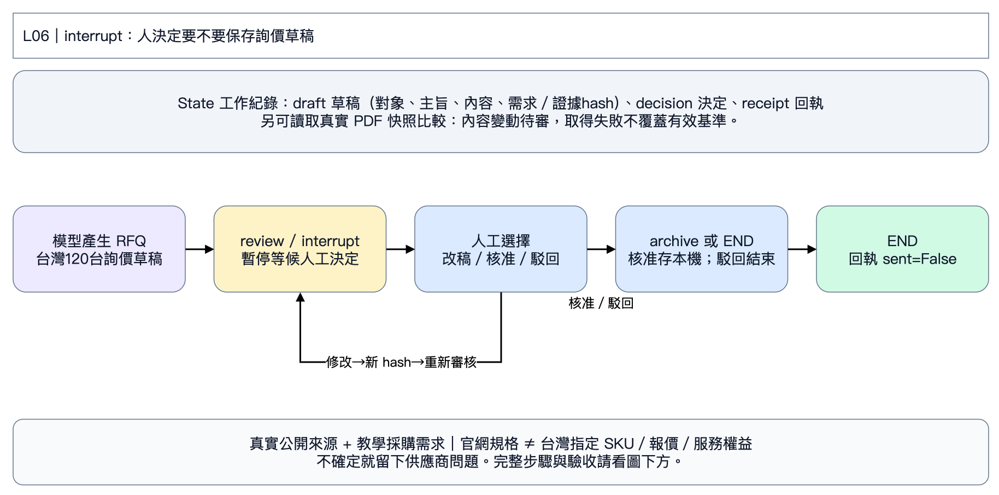

# L06｜來源追蹤、詢價草稿與人工審核

第二天｜台灣企業 120 台商務筆電採購案｜先看狀態圖，再依五步操作。

模型產詢價草稿 → interrupt 等人決定 → 修改再審／駁回結束／核准存本機 outbox。官網追蹤是另外的讀取檢查，不會自動核准任何草稿。

**State 是工作紀錄：** draft 收件對象、內容與需求hash；decision 決定；receipt 本機存檔回執；pending 是否等候。節點是分工，箭頭是下一步；只有 L05、L06 示範把狀態保存到 SQLite，L03重跑會重新呼叫模型；L04相同輸入會沿用已完成角色的回覆快取，修改需求後才產生新回覆。

**情境：** 業務／顧問 60 台、工程／分析 40 台、行政／管理 20 台，共 120 台；含稅總預算 NT$600 萬，預計 2027-01-15 前交貨。比較 HP EliteBook 8 G1a 14 Next Gen AI、Lenovo ThinkPad T14 Gen 6 AMD、Dell Pro 14 Plus PB14250 **Core Ultra 200V**。需要 32 GB、1 TB、出差配置 ≤1.5 kg、Win11 Pro、底座／雙螢幕、安全、台灣三年到府與正式報價。

**資料界線：** 企業、數量、預算及日期是教學情境；產品與服務片段來自真實官方網頁，查閱日為 2026-11-05。29 筆中有 27 筆可用、1 筆桌機服務陷阱、1 筆 HP 搜尋索引待核實線索。官網能力或海外 SKU 不等於台灣出貨／保固／報價。預算除以台數的 NT$50,000 是情境上限，不能當成市場價格。沒有台灣報價，結論可以是「待詢價」。

對照 PDF 307–350；建議 50 分鐘。程式格請在[本章Colab](https://colab.research.google.com/github/ywchiu/hp_agent/blob/main/workshop_20261105/notebooks/06_review_monitor.ipynb)播放。使用Antigravity時貼[本章指令](../prompts/07_review.txt)；程式入口見[第二天教材](../day2/README.md)。

## 第 1 步｜開啟本章，準備資料

**為什麼：** 每份 notebook 都自帶完整明文程式、採購需求及來源片段，可以獨立跑，不依賴上一章 Colab 暫存檔。

**怎麼做：** 存一份 Colab 副本，選 Python 3、CPU。由上往下播放下面三格；程式預設收起，不用展開修改。最後會看到來源表。可點來源網址核對內容，網站有時會擋機器連線，因此課堂主流程使用附帶的封存摘述，不會假裝剛完成線上搜尋。

**看什麼：** GLOBAL 是系列能力，IE 是愛爾蘭 SKU，TW 服務頁也未必是這一台已購買的服務。HP-SPEC 目前僅搜尋索引可見、直接存取 403，程式會排除它。

**卡住時給 AI：**「請依最後一段錯誤修復這個 Colab，保留 LangGraph、來源查核與未知值，只告訴我需要替換及重跑的格子。」只貼錯誤與對應格，不貼 Key。若要求重啟執行階段，重啟後從本步重跑。

## 第 2 步｜輸入課堂 Key

**怎麼做：** 播放下格，在輸入框貼上老師提供的 Key，按 Enter。預設模型是 `gpt-6-luna`，不用自己申請 Key。每份 notebook 都需輸入，執行階段結束後會消失。

**應該看到：** Key 已暫存與模型名稱，不會顯示 Key。本章真的呼叫模型，重跑會產生用量。401 請老師確認 Key；429 請老師確認課堂額度；模型不存在時使用老師指定名稱。只回報錯誤碼，不貼 Key，不要將 Key 放進 AI 對話或 GitHub。

### 選做：在全新 Colab 還原既有備份

第一次上課跳過。若已有含輸入資料及SQLite的完整備份ZIP，可用左側「檔案 → 上傳」放入，再只填下格檔名並播放。L05可使用第4步產生的中斷現場備份。接下來照原步驟操作；程式會沿用已還原的任務，不重新建立。請用全新執行階段，不能覆蓋已有成果的資料夾。

## 第 3 步｜產生詢價草稿，停在人工審核

**怎麼做：** 播放下格。模型依九項需求及真實來源寫 RFQ 草稿，LangGraph 以 interrupt 暫停。這份草稿是要求供應商補報價、SKU及服務證明，不是訂購承諾。

**應該看到：** pending=True、outbox_count=0、sent_count=0，並顯示草稿及 hash。hash 是整份草稿的指紋，收件對象、內容或需求變動都會改變。使用 .invalid 教學地址，這套範例沒有寄信工具。

## 第 4 步｜修改草稿，讓舊核准失效

**怎麼做：** 只改下格 ADD_REQUIREMENT 中文，例如要求報價逐項列出三年到府與交期。按播放，會保留原文、加入你的要求，再次等待審核。這是你手動修改草稿，不會再呼叫模型。

**應該看到：** hash 改變、仍 pending=True、零存檔、零寄送。內容改了，舊 hash 不能拿來核准新稿。

**給 AI：**「請將我的補充條件改寫成一句供應商可回答的詢價問題，保留台灣市場、交付SKU和服務條件，不編造報價，只回傳 ADD_REQUIREMENT 中文字串。」

## 第 5 步｜決定是否核准，並讀取真實來源快照

**怎麼做：** 先閱讀新草稿，再在 DECISION 選 approve 或 reject。核准只會把指定版本存入本機 outbox 一次；駁回不存。下格也會測試舊 hash 被拒絕、重複決定不增加紀錄。

**應該看到：** approve 後 outbox_count=1、sent_count=0；reject 為0、0。要測另一分支，請改新的 REVIEW_DIR 從第3步重做，不要刪原證據。

**選做來源追蹤：** 第二格將 CHECK_WEB 改 True，會實際下載 Lenovo 官方 PSREF PDF 並保存本次時間與 SHA-256。首次建立基準；日後再執行同格比較。unchanged 是檔案沒變、content_changed_needs_review 是內容指紋變動待人工讀文件、data_error 是讀取失敗。檔案變化不能直接稱為價格下跌；失敗不能覆蓋有效基準。

**兩週後怎麼做：** 請老師保留 `results/06_review`，包括 `monitor/baseline.json`，兩週後在同目錄再播放追蹤格。Colab 暫存資料可能被回收，保存 notebook 不會保留這些檔案。教材沒有捏造歷史報價或已發生的降價，也沒有在 Colab 部署持續排程。沒有官方含稅價格和相同SKU，不能算折扣。新證據若影響已核准草稿，請用新 REVIEW_DIR 重新產稿與審核。
